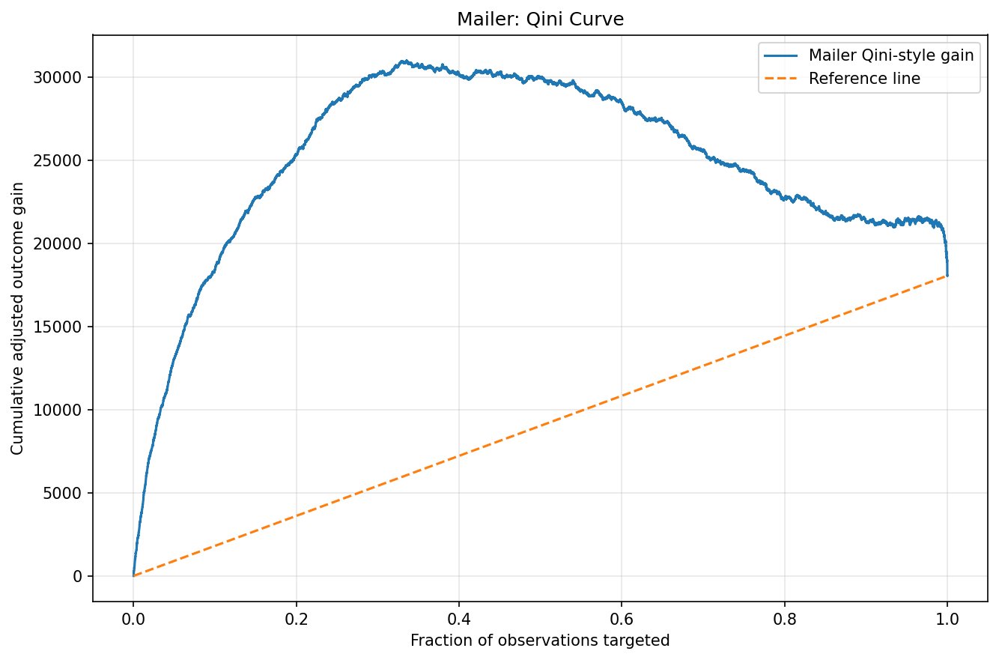
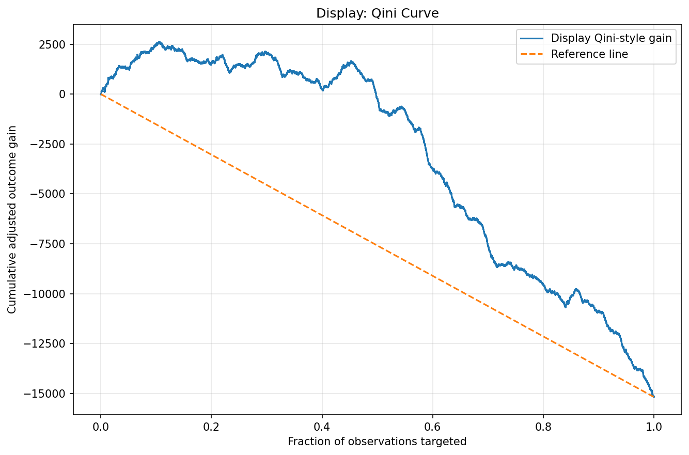
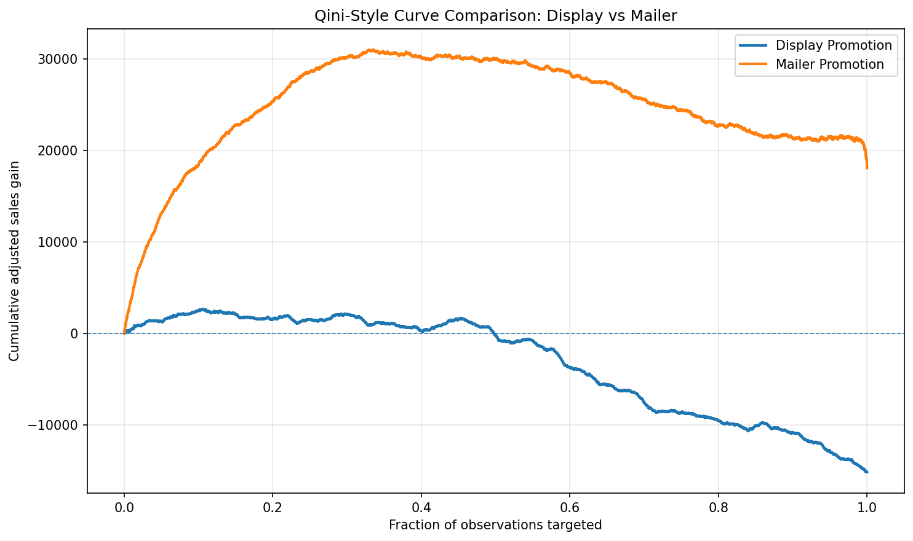

# EconoCausal: Dynamic Pricing and Promotion Effect Evaluation

## Project Overview

This project explores causal-effect estimation for retail promotions using the **Dunnhumby – The Complete Journey** dataset. The work compares estimated effects for two promotional treatments:

- **Display promotion** — exposure to in-store/display promotion.
- **Mailer promotion** — exposure to mailer promotion.

The project uses Individual Treatment Effect (ITE) estimates and Qini-style cumulative gain curves to explore how well treatment-effect scores rank observations for targeted promotion.

> **Important:** These are exploratory, Qini-style evaluation plots. They should not be interpreted as proof that a promotion caused the observed outcome or as validated business uplift estimates without checking the treatment/outcome definitions, row alignment, confounding assumptions, and evaluation methodology.

## Current Results

### Mailer promotion

The mailer curve rises sharply and reaches a peak of roughly **31,000 cumulative adjusted gain** around the first third of observations targeted, then declines toward approximately **18,000** by the end. It remains above the plotted reference line across the targeting range.

### Display promotion

The display curve reaches a modest positive peak of roughly **2,500** early in the ranking, fluctuates, then drops below zero around the middle of the targeting range and ends near **−15,000**.

### Comparison

In the current plots, the mailer curve shows substantially larger positive cumulative gain than the display curve. The display curve's decline suggests that targeting additional observations according to the current display score may be unhelpful under this evaluation setup.

These results are descriptive of the current curves only. **Do not conclude that mailer promotions are definitively more effective** until both treatments are evaluated with consistent outcome definitions, comparable scales, valid counterfactual estimates, and a documented Qini/uplift calculation.

## Visual Results

Add the following PNG files to the same folder as this README (or update the paths below to match your repository structure):

### Mailer Qini-style curve

### Display Qini-style curve

### Display vs. Mailer comparison

## Repository Artifacts

| File | Description |
|---|---|
| `mailer_qini_curve.png` | Mailer promotion cumulative gain plot |
| `display_qini_curve.png` | Display promotion cumulative gain plot |
| `display_vs_mailer_qini.png` | Side-by-side treatment comparison |
| `mailer_qini_curve.csv` | Data points used for the mailer curve |
| `display_qini_curve.csv` | Data points used for the display curve |

Update this table if the filenames or directory structure in the repository differ.

## Suggested Workflow

1. Load and validate the transaction and promotion data.
2. Define the treatment, outcome, and pre-treatment control variables.
3. Prepare consistent training and evaluation samples.
4. Estimate treatment effects using the selected causal machine-learning method.
5. Rank observations by estimated treatment effect.
6. Generate the cumulative gain/Qini-style curves on a held-out evaluation sample.
7. Compare treatments only after confirming that the curves use compatible definitions and scales.
8. Document assumptions, limitations, and reproducibility details.

## Interpretation and Limitations

- **ITE estimates are model estimates**, not directly observed individual causal effects.
- A ranking curve depends on the outcome, treatment indicator, score direction, baseline/reference construction, and sample used.
- The curves should be validated on held-out data to reduce overfitting.
- Check that rows in each score file are correctly matched to the corresponding observed outcomes and treatment assignments.
- Consider treatment selection bias, confounding, missing zero-purchase product-store-week combinations, and uncertainty in the estimates.
- Qini curves from separate treatment models may not be directly comparable if the samples, outcomes, units, or scaling differ.
- Business recommendations should also consider promotion cost, margin, inventory, and operational constraints—not just cumulative gain.

## Tools

The implementation may use Python, pandas, causal machine-learning libraries, and Plotly for visualization. Add the exact library versions and execution instructions used by your notebook to make the project reproducible.

## How to Run

1. Clone or download this repository.
2. Create and activate the Python environment used for the project.
3. Install the dependencies listed in the project's requirements file, if provided.
4. Open and run the relevant notebook in order.
5. Confirm that input data paths and column names match the files available locally.

The raw Dunnhumby dataset may require a separate download and is not included by this README.

## Next Steps

- Verify the exact Qini/uplift formula and reference line used in the plots.
- Evaluate the curves on a held-out sample.
- Add confidence intervals or bootstrap uncertainty estimates.
- Include a reproducible data-preparation and model-training pipeline.
- Report model diagnostics and business-relevant metrics, including costs and margins.
